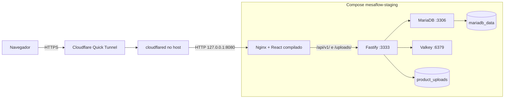

# Homologação do MesaFlow

O staging permite validar o frontend compilado, a API e os fluxos de ponta a ponta, incluindo QR Codes, em uma implantação semelhante à de produção. O projeto Compose `mesaflow-staging` combina `docker-compose.production.yml` com `docker-compose.staging.yml`. O Nginx entrega o React, encaminha `/api/v1/` e `/uploads/` ao Fastify e publica apenas `127.0.0.1:8080` no host. O `cloudflared` roda no host e oferece uma URL HTTPS temporária para acesso externo.



## Ambientes

| Ambiente | Configuração | Uso |
|---|---|---|
| Development | `docker-compose.yml` | Desenvolvimento com Vite, recarga de código e portas próprias para frontend, API e banco. |
| Testing | `docker-compose.test.yml` | Testes de integração com MariaDB isolado, publicado em `127.0.0.1:3308` e com dados temporários em `tmpfs`. |
| Staging | Compose de produção com `docker-compose.staging.yml` | Homologação com dados próprios, Nginx local na porta 8080 e acesso externo opcional por túnel. |
| Production | `docker-compose.production.yml` | Publicação com `production.env` e Nginx na porta 80 na configuração base. Veja o [guia de produção](production.md). |

## Pré-requisitos

- Docker Engine em execução e Docker Compose 2.24.4 ou posterior, com suporte a `!override`.
- Node.js com npm, OpenSSL e curl no host.
- Porta TCP 8080 livre no loopback e acesso à internet para baixar imagens, instalar dependências durante o build e conectar o túnel.

### Instalação do cloudflared

No Linux, instale pelo repositório de pacotes da Cloudflare ou baixe o pacote `.deb` ou `.rpm` da sua arquitetura. Por exemplo, em Debian ou Ubuntu, após baixar o arquivo, execute `sudo apt install ./cloudflared-linux-amd64.deb` (ajuste o nome à arquitetura). No macOS, use `brew install cloudflared`. No Windows, baixe o executável oficial, disponibilize-o como `cloudflared.exe` no PATH e use WSL ou um shell compatível para os exemplos em Bash. [Downloads oficiais do cloudflared](https://developers.cloudflare.com/cloudflare-one/networks/connectors/cloudflare-tunnel/downloads/)

Confirme a instalação com `cloudflared --version`.

## Configuração e inicialização

Na raiz do repositório, se ainda não existir um `.env.staging`, copie o modelo e restrinja o acesso ao arquivo.

```bash
cp -n .env.staging.example .env.staging
chmod 600 .env.staging
```

Para o primeiro uso, gere credenciais independentes para root, para o usuário da aplicação e para a assinatura JWT.

```bash
openssl rand -hex 32     # MARIADB_ROOT_PASSWORD
openssl rand -hex 32     # MARIADB_PASSWORD
openssl rand -base64 48  # JWT_SECRET
```

Preencha `.env.staging` com os valores gerados. Na `DATABASE_URL`, substitua `change-me` pela mesma senha de `MARIADB_PASSWORD`, mantendo o usuário `mesaflow`, o host `database:3306` e o banco `mesaflow`. A senha hexadecimal pode ser inserida diretamente. Mantenha `VALKEY_URL=redis://valkey:6379` e defina inicialmente `FRONTEND_URL=http://127.0.0.1:8080`. Remova do shell variáveis exportadas com os mesmos nomes para evitar que sobrescrevam o arquivo na interpolação do Compose.

```bash
npm run staging:config -- --quiet
npm run staging:build
npm run staging:up
npm run staging:ps
curl -fsS http://127.0.0.1:8080/api/v1/health
```

O primeiro start aguarda MariaDB e Valkey ficarem saudáveis para iniciar o backend. Se o teste HTTP falhar enquanto os containers sobem, consulte `npm run staging:logs -- --tail=100 database backend nginx`.

## Acesso externo com Quick Tunnel

Em outro terminal no mesmo host, execute `npm run staging:tunnel` e mantenha o processo aberto. Copie a origem HTTPS `https://<subdomínio>.trycloudflare.com` exibida no terminal. Atualize `FRONTEND_URL` no `.env.staging` com essa origem, sem caminho nem barra final. O backend usa esse valor na configuração de CORS e nos links do cardápio gerados para os QR Codes.

```bash
npm run staging:up -- --no-deps --force-recreate backend
npm run staging:restart -- nginx
```

A recriação carrega o novo ambiente no backend. O reinício do Nginx resolve novamente o endereço interno do backend. Abra a URL pública e confira `/api/v1/health` e um QR Code recém-gerado. Ao abrir outro túnel, repita a atualização e gere novamente os QR Codes que ainda apontam para o endereço antigo. Para voltar ao acesso exclusivamente local, restaure a origem local e execute os mesmos dois comandos.

Por padrão, qualquer pessoa com a URL pode acessar a aplicação exposta. A sessão termina quando o `cloudflared` é encerrado, e cada novo túnel recebe um hostname diferente. O Quick Tunnel não tem garantia de disponibilidade, aceita até 200 requisições simultâneas (acima do limite, responde com HTTP 429) e não suporta SSE. [Documentação do Quick Tunnel](https://developers.cloudflare.com/tunnel/get-started/quick-tunnels/)

## Atualização e persistência

Para publicar alterações no código, rode `npm run staging:build` e `npm run staging:up`. O build recompila as imagens do backend e do Nginx e busca atualizações das imagens base. Para atualizar também as imagens prontas de MariaDB e Valkey, faça backup do banco e dos uploads e execute:

```bash
docker compose -p mesaflow-staging --env-file .env.staging \
  -f docker-compose.production.yml -f docker-compose.staging.yml pull database valkey
npm run staging:up
```

O Compose usa rede própria e volumes `mesaflow-staging_mariadb_data` e `mesaflow-staging_product_uploads`. O MariaDB importa `mesaflow_schema_v1.sql` ao inicializar um volume vazio. Alterações no schema ou nas senhas do arquivo de ambiente exigem atualização explícita no banco existente. Para atualizar o schema, siga os incrementais descritos no [guia de produção](production.md#atualização-de-banco-existente), usando os parâmetros do Compose de staging. O Valkey não possui volume persistente declarado.

Use dados de teste e credenciais exclusivas. Mantenha `.env.staging` fora do Git e evite compartilhar a saída de `staging:config`, que inclui segredos. Restrinja a circulação da URL pública e encerre o túnel ao concluir a sessão.

## Problemas identificados na homologação

- **URLs da API e de imagens.** A imagem do Nginx compila o frontend com `VITE_API_URL=/api/v1`. O navegador mantém a origem HTTPS do túnel ao chamar a API. Para resolver uploads, o frontend usa a origem da URL da API. Construir uma URL absoluta diretamente a partir de `/api/v1` sem uma base causava erro.
- **Compatibilidade com testes SSR.** O frontend resolve a API relativa usando `window.location.origin` no navegador e recorre a `http://localhost:3333` em testes sem `window`. O teste `frontend/tests/resolve-image-url.test.mjs` cobre esses cenários e URLs absolutas. O gráfico de vendas também passou a enviar uma única string ao elemento SVG `<title>` durante a renderização.

## Solução de problemas

| Sintoma | Verificação |
|---|---|
| Erro ao ler `!override` | Confira a versão com `docker compose version` e atualize o plugin Compose. |
| Porta 8080 ocupada | Identifique o processo que usa o loopback e libere a porta antes de subir o Nginx. |
| Banco inacessível ou backend reiniciando | Confira os logs de `database` e `backend`, a senha da `DATABASE_URL` e o `JWT_SECRET`. Em volume existente, confirme a senha cadastrada no MariaDB. |
| HTTP 502 | Teste primeiro a URL local e confira os logs de `nginx` e `backend`. Se o backend acabou de ser recriado, reinicie o Nginx. |
| CORS ou QR Code apontando para outra origem | Confirme a URL atual em `FRONTEND_URL`, recrie o backend, reinicie o Nginx e gere um novo QR Code. |
| Quick Tunnel não inicia | Confirme que o Nginx responde localmente e verifique os logs do `cloudflared`, a conectividade e possíveis conflitos com uma configuração de túnel já existente no host. |

## Encerramento

Pressione `Ctrl+C` no terminal do túnel e execute `npm run staging:down`. O comando remove os containers e a rede de staging e preserva os volumes nomeados. Mantenha o `down` sem a opção `--volumes` para reutilizar os dados no próximo `npm run staging:up`.
